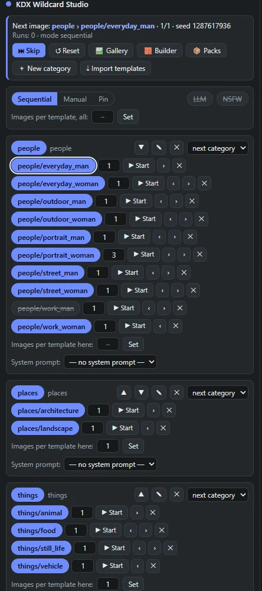
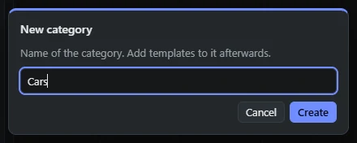
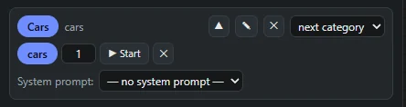
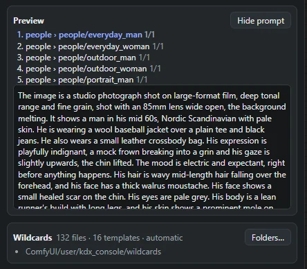

# The panel

Open it with the **KDX Wildcard Studio** tab in ComfyUI's left sidebar (the slider icon), or with the ⚙ button on the node.
Everything you set here is stored in `user/kdx_console/config.json`; changes take effect on the next run, no
restart and no refresh needed.

## The top card

- **Next image**: the category › template the next run will use, its position (`1/1` = first of one image) and the
  wildcard seed chosen in advance. Below: how many runs the Studio has made and the mode.
- **⏭ Skip** jumps to the next template (and resumes after `on_end = stop`). **↺ Reset** starts the counter again
  from the first enabled template.
- **🖼️ Gallery** opens every image the Studio made: [Gallery](10-gallery.md).
- **🧱 Builder** opens the [Template builder](11-template-builder.md) (and from there the
  [pool editor](12-pool-editor.md)).
- **📦 Packs** shares templates as a `.zip` or installs one: [Packs](14-packs-guide.md).
- **＋ New category** creates an empty category. Give it a name and add templates to it afterwards (with
  **＋ Add template…** in the category, or from the builder's **Add to**).

  

- **⇣ Import templates** adds every template in `templates/` that is not in a category yet. Flat files go to the
  category **Templates**, files in `templates//` to a category named after the sub-folder. Existing settings are
  kept, and templates you removed in the panel stay out (see **Restore all** below the buttons when there are any).

## Mode and the two pills

- **Sequential** (default) walks through the enabled templates; **Manual** always uses the one you pick with **▶ Use**;
  **Pin** repeats one template with a fixed seed. Details: [How it works](02-how-it-works.md#modes).
- **Images per template, all** + **Set** writes one `repeat` into every template of every category.
- **LLM** pill: on = the category's system prompt goes to the `system_prompt` output and `llm_enabled` is true, so a
  connected KDX-LLM Chat rewrites the prompt. Off = the prompt passes unchanged.
- **NSFW** pill: off = templates whose names start with `nsfw`, `akt` or `sheer` stay out of Add template, Import, the
  Gallery, the builder's pool users and Packs. Templates already in a category keep running either way.

A pill with a strike-through is off.

## A category

| Control | What it does |
|---|---|
| Category pill (**Cars**) | Switch the whole category on or off. The grey text next to it is its key (`cars`), used by [overrides](03-overrides.md) |
| ▲ ▼ | Move the category up or down (the order of the run) |
| ✎ | Rename it (the key stays) |
| ✕ | Remove the category from the panel. No file is deleted |
| next category / loop category / stop | `on_end`: what happens after its last template |
| Template pill (**cars**) | Switch one template on or off. Outlined = the next image uses it; a dot = the last image was made with it |
| Number | `repeat`: how many images this template makes before the next one follows |
| ▶ Start / ▶ Use | Continue the sequence from here (Sequential), or pick this template (Manual, Pin) |
| ‹ › ✕ | Move the template inside the category, or remove it from the category (the file stays) |
| ＋ Add template… | Add any template that is not in a category yet (shown only when there is one) |
| Images per template here + Set | One `repeat` for every template of this category |
| System prompt | The KDX-LLM profile sent while the LLM pill is on |

To move a template to another category: ✕ it here, then **＋ Add template…** there.

## Preview and Wildcards

- **Preview** lists the next five runs. **Show prompt** expands the next prompt exactly as the next run will use it
  (same seed), so you can read it before you queue.
- **Wildcards** shows how many files and templates the library has and which folders are read. **Folders…** sets other
  folders (several separated by `;`); empty = automatic (`user/kdx_console/wildcards/`). See [Wildcards](07-wildcards.md).

## Shared or per workflow

When the open workflow has a Studio node, a card at the top reads **On/off for: Shared | This workflow**. Shared
(default) means a click changes every workflow. **This workflow** keeps separate on/off switches and a separate
counter in the node, saved with the workflow. Details: [How it works](02-how-it-works.md#settings-per-workflow).
