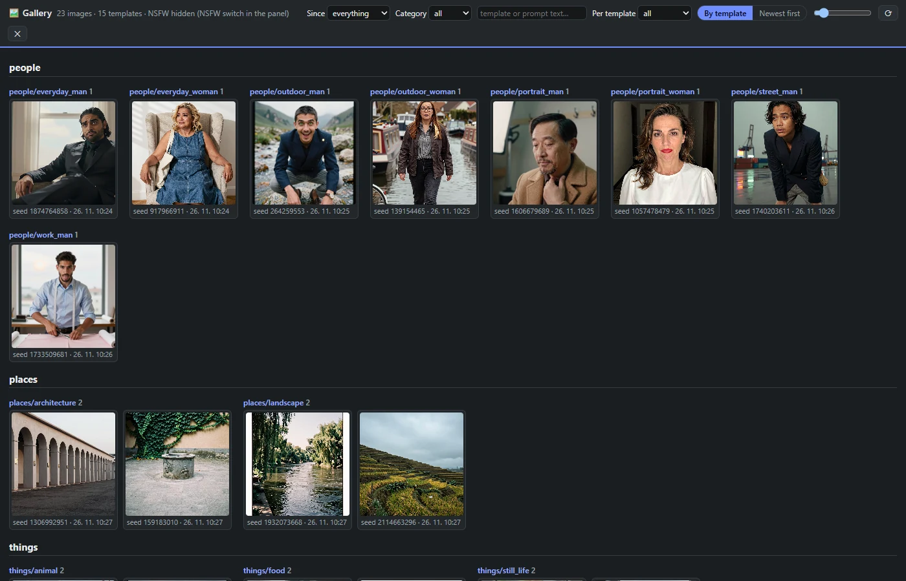
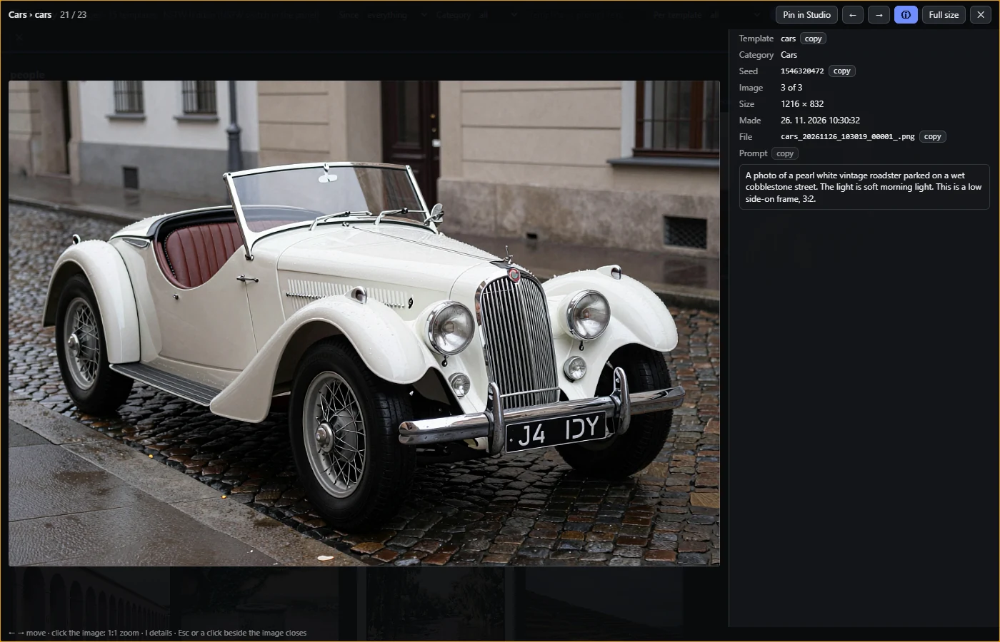

# Gallery and viewer

**🖼️ Gallery** in the panel shows every image KDX Wildcard Studio made, grouped by category and template, with the
template, seed and exact prompt of each image. It reads the images in ComfyUI's output folder; nothing is copied.

## Filters (top bar)

| Control | What it does |
|---|---|
| **Since** | Time range: last hour, last 6 hours, today, last 24 hours, last 7 days, everything, or since a date you pick |
| **Category** | Only one category |
| Search field | Template name or any text of the prompt (`roadster`, `fog`, `vehicle`) |
| **Per template** | Only the newest 1, 3, 5 or 10 images of every template — a quick overview of a long run |
| **By template / Newest first** | Grouped by category and template, or one stream, newest first |
| Slider | Thumbnail size |
| ⟳ / ✕ | Load again / close (Esc) |

The line next to the title counts the images and templates shown. "NSFW hidden" means the panel's NSFW pill is off,
so images of NSFW templates are not listed. The gallery loads when it opens and when you change a filter; press ⟳
after new runs.

Only images saved after a KDX Wildcard Studio run carry their template. The exact prompt is stored in images made with
Studio 0.6.9 or newer; older images show the longest text input of their workflow instead.

## The viewer

Click a thumbnail to open it.

- **← →** (buttons or arrow keys) step through the images in the order of the grid.
- A click on the image toggles 1:1 zoom; **Full size** opens the image in a new browser tab.
- **ⓘ** (or the `I` key) shows or hides the details: template, category, seed, image *n of repeat*, size, time,
  file name and the full prompt. **copy** puts a value on the clipboard.
- **Esc** or a click beside the image closes the viewer.

### Keep parts

**🔒 Keep parts** takes this image's prompt apart into the wildcard picks that made it. You keep the parts you like
and the rest varies in the next images. See [Keep parts](16-keep-parts.md).

### Save as template

Images made from your own text (`user_text` / `user_prompt`, template `user_prompt`) have **Save as template…**: it
writes that text, wildcards included, as `templates/<name>.txt`. Lines are joined into one. Add the new template
to a category in the panel.

### Pin in Studio

**Pin in Studio** switches the Studio to **Pin** mode with this image's template and seed. The next run makes the
same prompt again (with the same workflow and model settings, the same image). The panel then shows **Pin** as the
mode; switch it back to **Sequential** when you are done. Dragging the image file onto the ComfyUI canvas does the
same: see [Reproducible images](04-reproducible-images.md).
