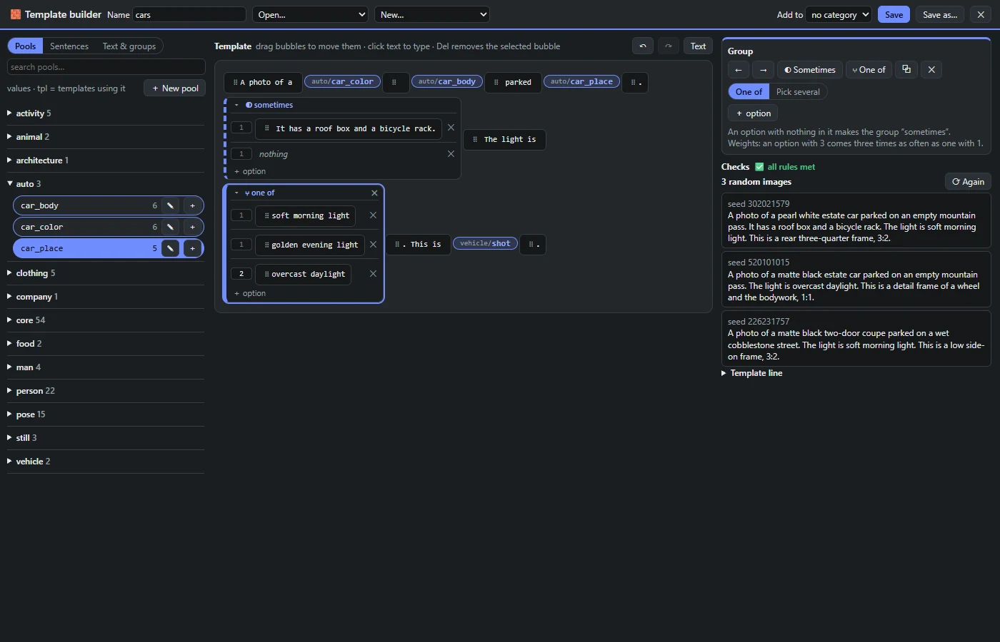
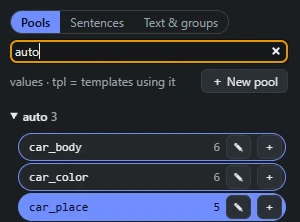
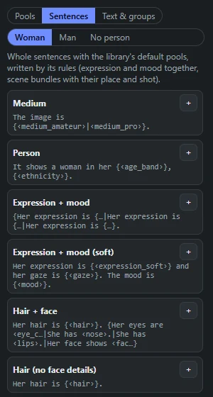
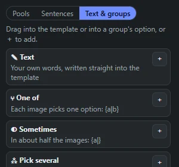
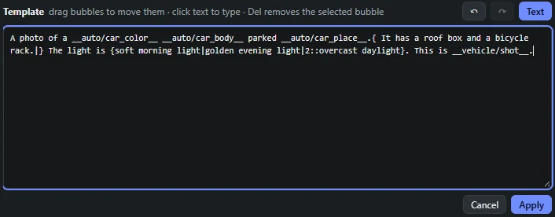
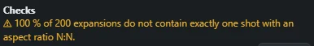
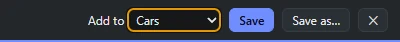

# Template builder

**🧱 Builder** in the panel builds a template from bubbles instead of typing wildcard syntax. A template is one line
of text; the builder shows it as a row of bubbles that reads left to right, checks it against the library's rules
and shows three random prompts while you work.

The window has four parts:

1. **Top bar**: the template's **Name** (the file `templates/<name>.txt`, `a-z 0-9 _`), **Open…** an existing
   template, **New…** to start from scratch, **Add to** a category, **Save** and **Save as…**.
2. **Palette** (left): what you can put into the template.
3. **Canvas** (middle): the template as bubbles.
4. **Inspector, checks and preview** (right).

## Start

- **New… › empty** starts with an empty canvas.
- **New… › woman / man / no person (all sentences)** starts with every ready sentence of the library (medium, person,
  expression and mood, hair, clothing, pose, place, light, shot, realism, palette). Remove what you do not need.
- **Open…** takes any existing template apart into bubbles, whoever wrote it. Saving it again gives the same line
  when you changed nothing.

## The palette

| Pools | Sentences | Text & groups |
|---|---|---|
|  |  |  |

- **Pools**: every folder of the library with its pools and their number of values. Type in the search field to
  filter. A click on a pool shows its values and description on the right; **✎** opens the
  [pool editor](12-pool-editor.md); **＋ New pool** creates one.
- **Sentences**: whole sentences written by the library's rules, for a woman, a man or no person (for example
  "expression + mood" picked together, or a pose with its scene).
- **Text & groups**: a **Text** bubble for your own words and the three kinds of group (below).

Drag an item onto the canvas (between two bubbles, or into a group's option), or press its **＋** to add it after the
selected bubble (or at the end).

## Bubbles

- **Text bubble**: your own words, written into the template as they are. Click it and type.
- **Pool bubble** (`auto/car_color`): one random value of that pool per image. Written as `__auto/car_color__`.
- **Group** (a box with options, one option per row, each with a weight):

| Group | Each image… | Written as |
|---|---|---|
| ⑂ **One of** | picks one option; a weight of 2 makes an option twice as likely | `{soft light\|2::overcast daylight}` |
| ◐ **Sometimes** | uses the option in about half the images (one option plus an empty "nothing") | `{ It has a roof box.\|}` |
| ⁂ **Pick several** | picks several different options (2, or a range like `1-3`) joined by a text you choose | `{1-2$$, $$a\|b\|c}` |

Options take bubbles too, so groups can be nested. **＋ option** adds a row, ✕ removes one, ▾ folds the group.

Editing: drag a bubble by its ⠿ grip to move it; **Del** removes the selected bubble; **Alt+← →** moves it;
**Ctrl+Z / Ctrl+Y** undo and redo. When a bubble is selected, the inspector (top right) offers ← →, wrap it in
**Sometimes** or **One of**, ⧉ duplicate and ✕; for a group it switches between One of and Pick several.

### Text view

**Text** shows the whole line as text. Edit or paste a line, then **Apply** turns it back into bubbles. Handy for a line
you already have:

## Checks and preview

Under **Checks** the builder tests the template on 200 random expansions:

- exactly one shot with an aspect ratio `N:N` in every prompt (reuse a shot pool such as `__vehicle/shot__`),
- every token names a pool that exists, written in full (`__folder/file__`),
- one line only,
- `core/light_sky` only next to places that are always outdoors,
- an expression always together with its mood,
- NSFW names (`nsfw…`, `akt…`, `sheer…`) without clothing,
- a name ending in `_woman` / `_man` matches the pronouns of the text.

A warning looks like this; the template can still be saved, but read it first:

**3 random images** shows three prompts with random seeds; **⟳ Again** draws new ones. **Template line** shows the
line that will be written. **🔒 Keep parts** on a sample keeps parts of that prompt and lets the rest vary
([Keep parts](16-keep-parts.md)); its **Open in Builder** brings the result back here as a new template.

## Save

- **Add to**: after saving, the template is added to this category of the panel (or to none).
- **Save** writes `templates/<name>.txt`. An existing file is only replaced after you confirm, and the old one is
  kept as `templates/<name>.txt.bak`. Once a template is open, the button reads **Save (replace)**.
- **Save as…** asks for a new name (it suggests a free one such as `portrait_copy_woman`), writes a new file and leaves
  the open template as it was. The copy goes into the same category as the original.

Closing the builder with unsaved changes asks first. Step-by-step example: [Your own theme from scratch](15-tutorial-own-theme.md).
