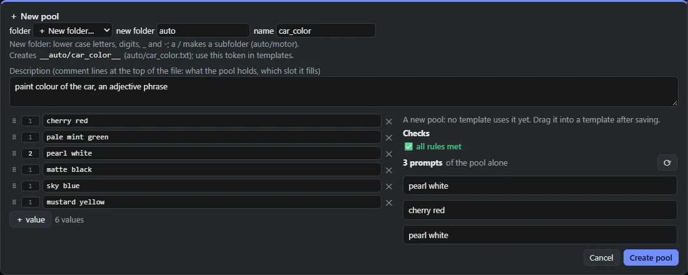
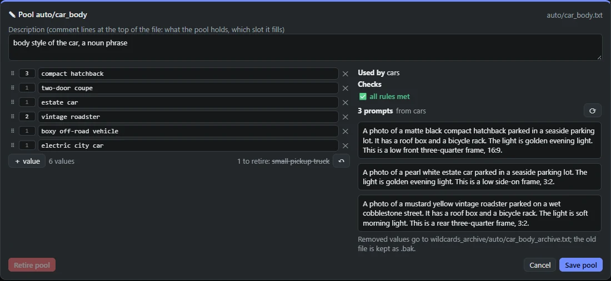
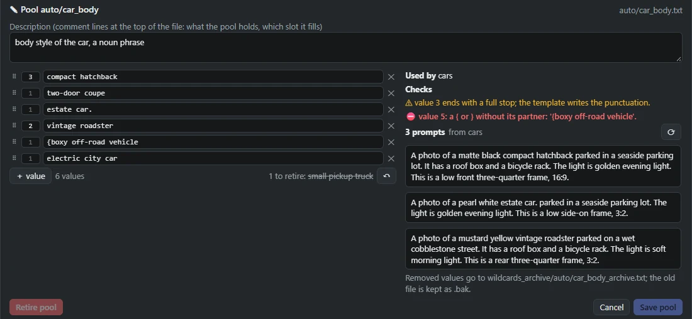

# Pool editor

The pool editor creates pools and changes their values without opening a text editor. Open it from the
[Template builder](11-template-builder.md): **＋ New pool** above the pool list, the ＋ beside a folder, or **✎** beside
a pool. (A pool is one `.txt` file of values; a folder only groups pools — see the [Glossary](08-glossary.md).)

## A new pool

1. **Folder**: pick an existing folder from the drop-down, or **＋ New folder…** at its end and type the new name
   (`auto`, or `auto/motor` for a sub-folder; lower case letters, digits, `_` and `-`). There is no separate "new
   folder" step: the folder is created together with its first pool. The window starts at "choose a folder…", or at
   the folder you opened it from (the ＋ beside a folder in the pool list).
2. **Name**: the file name, `a-z 0-9 _` (`car_color`). The line under the fields shows the token you will use in
   templates, for example `__auto/car_color__`, or what is still missing.
3. **Description**: what the pool holds and which slot it fills. It is written as `#` comment lines at the top of the
   file, so other people (and you, later) know how the values are meant to be read.
4. **Values**: one per row. The small number in front is the **weight** (empty or 1 = normal, 2 = twice as likely).
   **＋ value** or Enter in a value adds the next row; ✕ removes one.
5. **Create pool**. An existing pool is never overwritten.

## Editing a pool

- Change a value's text or weight in place; drag the ⠿ grip to change the order.
- ✕ **retires** a value: it is listed as "to retire" (↶ brings it back) and leaves the pool when you save.
- **Used by** lists the templates and pools that read this pool, also through short (`__car_color__`) and glob
  (`__auto/*__`) tokens. NSFW templates are listed only while the NSFW pill is on.
- **3 prompts** are made from one of those templates with your edited values, before you save. ⟳ draws new ones.
- **Save pool** writes the file. **Cancel** asks before it throws your changes away.

## Checks

Errors (⛔) block the save:

- an empty value, a broken weight or two weights on one line,
- a `{` or `}` without its partner,
- a token that names an unknown pool, or the pool itself,
- words or ages that put a minor in the picture (the same list Packs use).

Warnings (⚠) do not block: a full stop at the end of a value (the template writes the punctuation; `*scene*` pools
are the exception), double spaces, spaces at the ends, duplicates, short or glob tokens, and clothing words in a pool
that an NSFW template reads.

## Nothing is deleted

- Every save keeps the previous file as `<pool>.txt.bak` and writes the new one atomically.
- A value that leaves the pool (retired, or rewritten into new wording) is appended with the date to
  `wildcards_archive/<folder>/<pool>_archive.txt`, a folder **next to** the library where no engine loads it. To bring
  a value back, copy the line from there.
- **Retire pool** (bottom left) moves the whole pool into that archive. It works only while no template or pool uses
  the pool; otherwise the button is off and **Used by** shows who still needs it.
- The editor never touches `templates/` (the builder writes those) or `packs/` (installed packs keep their checksums),
  and never a path outside the wildcard folder.

After a save the builder's pool list, the values and the preview reload by themselves.
