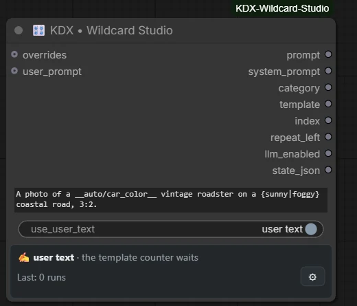

# Your own prompt on the node

Sometimes you want one image from a prompt of your own without building a template. The Studio node takes your
text in two ways. In both, wildcards work (`__auto/car_color__`, `{sunny|foggy}`) with a new pick every run, and the
template counter waits, so the Studio carries on where it stopped when you go back.

## 1. Type it into the node

1. Type your prompt into the node's text box (`user_text`).
2. Turn the **use_user_text** switch on. It then reads **user text**, and the node body shows
   "✍ user text · the template counter waits".
3. Run. Switch it off (it reads **templates**) and the templates are back.

The text is saved with the workflow, so you can keep a favourite prompt in the box and flip the switch when you need it.

## 2. Connect a text node to `user_prompt`

Connect any node that outputs text (for example **Text (Multiline)**, a String node, or the output of another node)
to the `user_prompt` input. While it sends text, that text is the `prompt` output. No switch is needed:

- **Mute** (Ctrl+M) or **bypass** (Ctrl+B) the text node, or leave it empty, and the template prompt comes back.

  

- A connected `user_prompt` wins over the `user_text` box.

## What the outputs say

While your own text is used:

| Output | Value |
|---|---|
| `prompt` | your text with its wildcards expanded |
| `category` | `user` |
| `template` | `user_prompt` (handy in **KDX • Filename** and in the [Gallery](10-gallery.md)) |
| `llm_enabled` | false: your text is the final prompt, KDX-LLM Chat passes it on unchanged |

The image records the text, the expanded prompt and the seed, so dragging it back onto the canvas repeats the same
prompt (see [Reproducible images](04-reproducible-images.md)). If the text node is gone by then, the node simply runs
the Studio.
