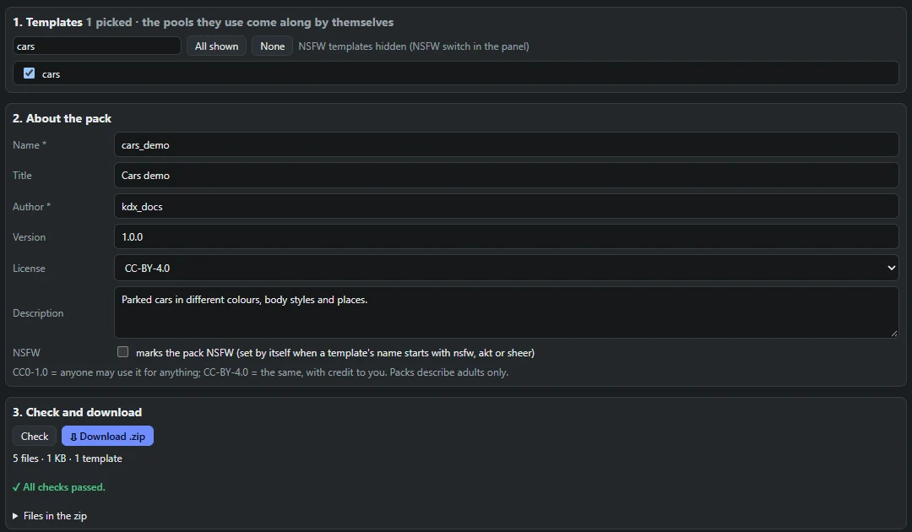
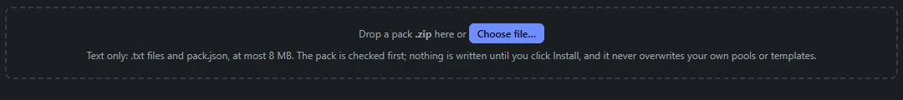
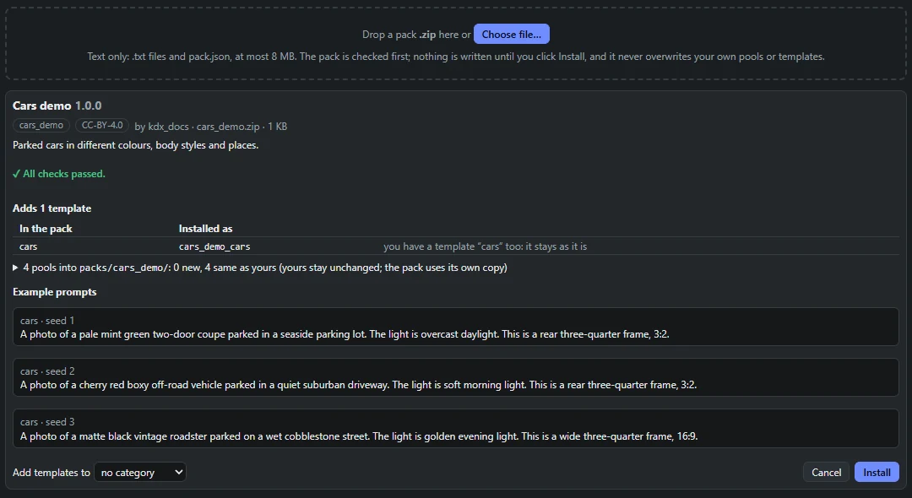
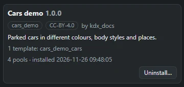
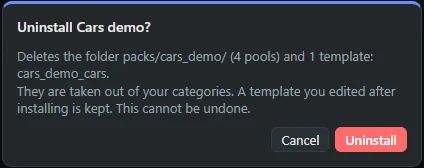

# Packs: share and install templates

A pack is a `.zip` with templates and every pool they need. **📦 Packs** in the panel has three tabs: **Installed**,
**Import** and **Export**. This page shows how to use them; the file format and every check are in [Packs](packs.md).

## Export: share your templates

1. **Templates**: type in the filter and tick the templates to share (**All shown** ticks every one the filter shows).
   You never pick pools: every pool the templates reach comes along by itself, also pools used inside other pools.
2. **About the pack**: **Name** (`a-z 0-9 _`, it becomes the install folder and the prefix of the templates),
   **Title**, **Author** (a nickname is fine), **Version**, **License** (default `CC0-1.0` = anyone may use it for anything, no credit needed;
   `CC-BY-4.0` = the same with credit to you) and a short **Description**. **NSFW** is ticked by itself when a template's
   name starts with `nsfw`, `akt` or `sheer`.
3. **Check** runs the same checks an import runs and lists the files; **⇩ Download .zip** saves the pack. A pack with
   errors is not exported.

NSFW templates are offered only while the NSFW pill is on. A template that uses an installed pack cannot be exported:
share that pack instead.

## Import: install someone else's pack

Drop the `.zip` on the box or use **Choose file…**. Nothing is written yet: you first see what the pack is and does.

- Title, version, name, license, author and description.
- The checks (text files only, at most 8 MB, every token found in the pack, adults only, the NSFW flag honest).
  A pack with errors cannot be installed.
- **Adds N templates** with the name each gets (`cars` → `cars_demo_cars`). If you have a template with the same name,
  yours stays as it is.
- The pools go into `packs/<name>/` of your library; the line tells you how many are new and how many equal yours.
  Your own pools are never overwritten: the pack's templates use the pack's own copies.
- **Example prompts** made from the pack's templates.
- **Add templates to**: no category, an existing category or a new one.

**Install** writes the files; **Cancel** forgets the zip. Installing the same pack again offers **Replace**.

## Installed and uninstall

Every installed pack with its version, license, author, templates and pools. **Uninstall…** asks first:

It deletes `packs/<name>/` and the pack's templates and takes them out of your categories. A template you edited after
installing is kept. This cannot be undone, but you can install the zip again.
