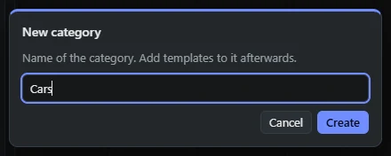
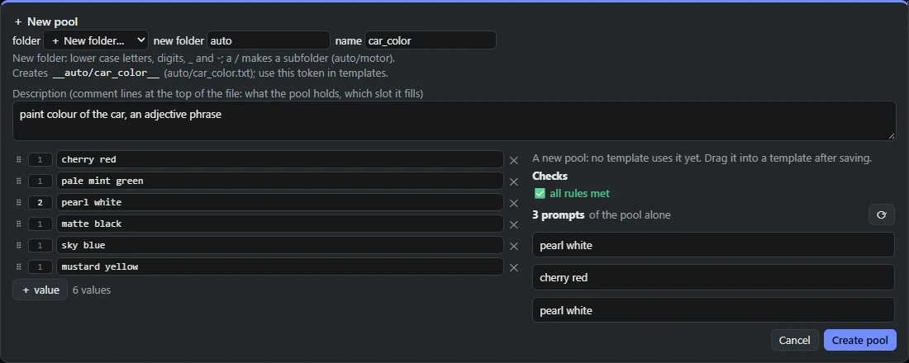
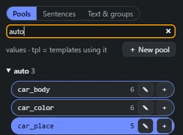
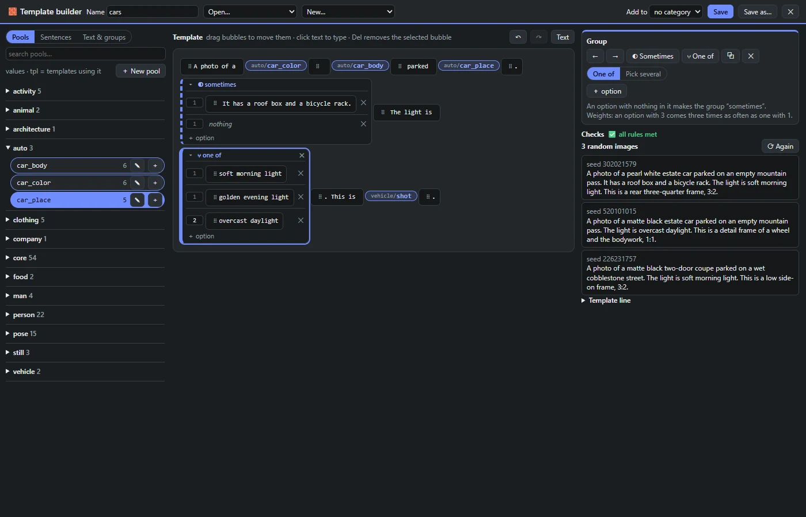
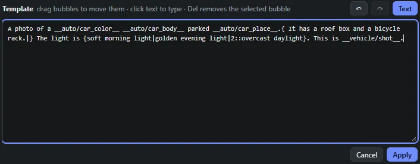
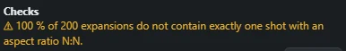
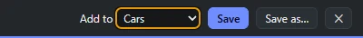
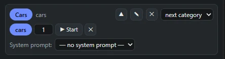

# Your own theme from scratch: parked cars

This walk-through builds a small theme from nothing, all in the browser: a folder `auto/` with three pools, one
template `cars` that uses them, and a category **Cars** in the panel. It takes about ten minutes. The words used here
(pool, folder, template, category) are explained in the [Glossary](08-glossary.md).

The result is a prompt like:

> A photo of a **mustard yellow** **compact hatchback** parked **on a wet cobblestone street**. It has a roof box and
> a bicycle rack. The light is **golden evening light**. This is **a front-on frame, 1:1**.

## 0. Create the category

In the panel, **＋ New category**, name it `Cars`, **Create**. It starts empty; the template lands in it in step 4.



## 1. Plan the slots

Write the sentence you want and mark what should change from image to image:

```
A photo of a [colour] [body style] parked [place]. (sometimes: roof box) The light is [light]. This is [shot].
```

- Things with many values and a meaning of their own become **pools**: colour, body style, place.
- A short choice that only this template needs can stay inside the template as a **One of** group: the light.
- Reuse what the library already has: a shot pool with an aspect ratio, `vehicle/shot`.

## 2. Create the pools

Open **🧱 Builder** in the panel, then **＋ New pool** above the pool list.



1. Folder: **＋ New folder…** → `auto` (the folder is created with this first pool).
2. Name: `car_color`. The line under the fields shows the token: `__auto/car_color__`.
3. Description: `paint colour of the car, an adjective phrase`.
4. Values, one per row, lower case, no full stop: `cherry red`, `pale mint green`, `pearl white` (weight 2, so it comes
   twice as often), `matte black`, `sky blue`, `mustard yellow`.
5. **Create pool**.

Repeat for the two other pools, now picking `auto` from the folder drop-down:

| Pool | Description | Values |
|---|---|---|
| `auto/car_body` | body style of the car, a noun phrase | `3::compact hatchback`, `two-door coupe`, `estate car`, `vintage roadster`, `boxy off-road vehicle`, `small pickup truck` |
| `auto/car_place` | where the car stands, with its preposition | `on a wet cobblestone street`, `on an empty mountain pass`, `in a seaside parking lot`, `in a quiet suburban driveway`, `in a neon-lit underground garage` |

Tip: write each value so it fits the words around the slot. `car_place` values start with their preposition
("**on** a wet street", "**in** a garage") because the template writes only "parked".

The pools now appear in the palette (type `auto` in the search field):



## 3. Build the template

1. **New… › empty**, and type `cars` as the **Name**.
2. From **Text & groups**, drag a **Text** bubble onto the canvas and type `A photo of a`.
3. From **Pools**, drag `auto/car_color`, then `auto/car_body`, a Text bubble ` parked `, `auto/car_place` and a Text
   bubble `.`.
4. Drag a **Sometimes** group after it and type ` It has a roof box and a bicycle rack.` into its option.
5. Text ` The light is `, then a **One of** group with three options: `soft morning light`, `golden evening light`,
   `overcast daylight` (weight 2).
6. Text `. This is `, the pool `vehicle/shot`, Text `.`.



If you already have the line, **Text** and **Apply** do the same in one step:



Look at **Checks**. Without the shot, the builder warns that no prompt has an aspect ratio:



With `vehicle/shot` in place it reads **all rules met**. Read the **3 random images** and press **⟳ Again** a few
times: every combination should be a sentence you would accept as a prompt.

## 4. Save into the category

Choose **Add to: Cars** (the category from step 0) and **Save**. The file `templates/cars.txt` is written and the
template is added to the category.



Forgot the category? Save with **Add to: no category**, close the builder, create the category and use
**＋ Add template… › cars** in it.

## 5. Run it

The panel now has the category:



- Set the number next to `cars` to how many images you want from it (`repeat`).
- To make only cars: switch the other categories off (click their pills), or use **Manual** and **▶ Use** on `cars`.
- **Preview › Show prompt** shows the exact next prompt. Queue as usual.

## 6. Improve it later

- New colours or places: **✎** beside the pool in the builder ([Pool editor](12-pool-editor.md)). A value you remove is
  kept in `wildcards_archive/auto/`, and the old file as `.bak`.
- A second template (`cars_night`, `cars_studio`): **Open… › cars**, change it, **Save as…**.
- Share the theme: **📦 Packs › Export**, tick `cars` — the three `auto/` pools and `vehicle/shot` come along by
  themselves ([Packs](14-packs-guide.md)).
